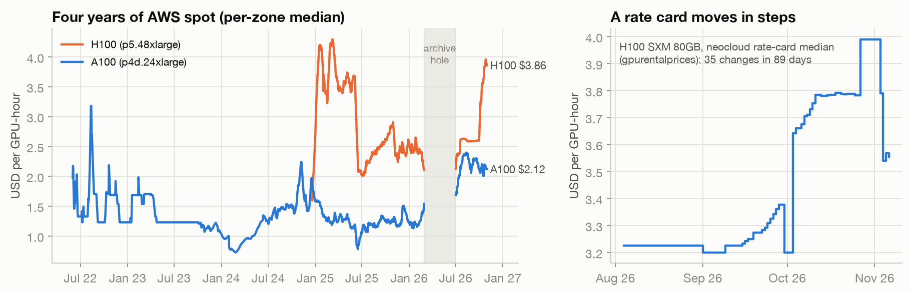
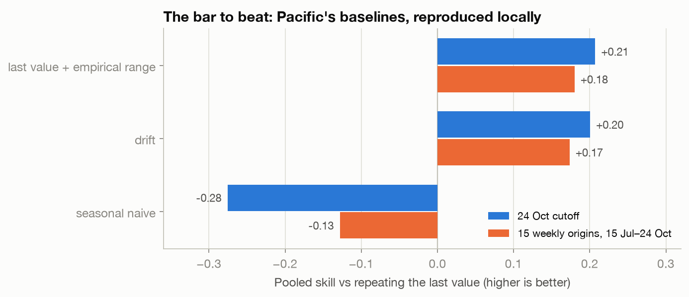
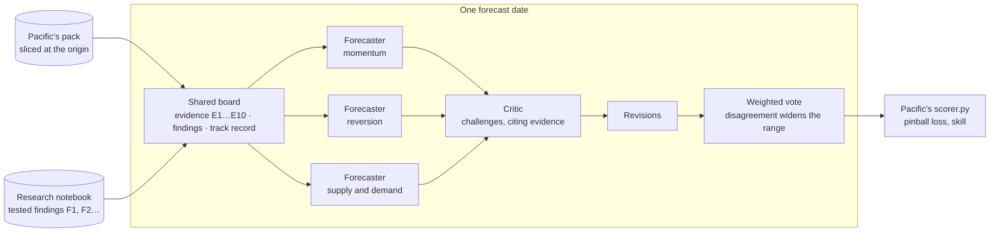
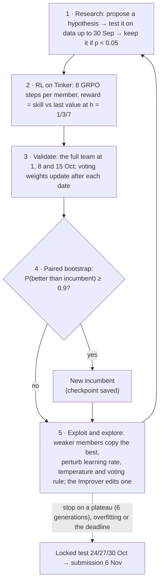
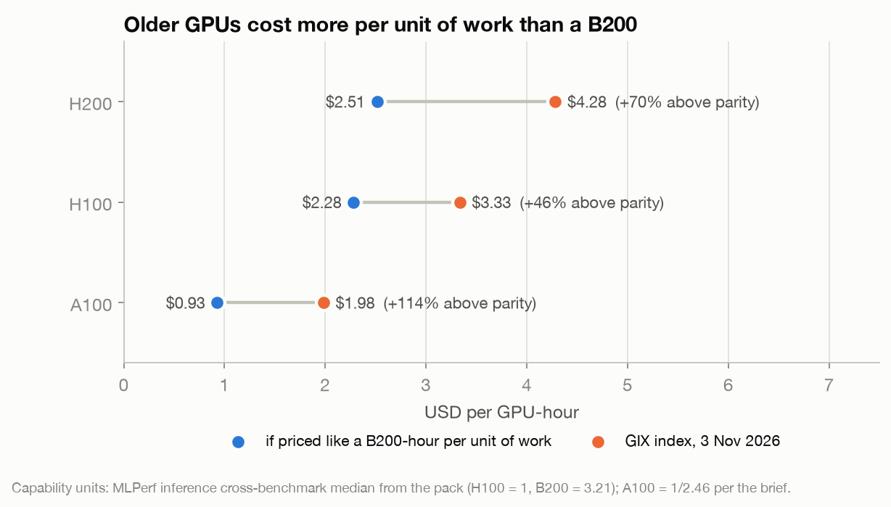
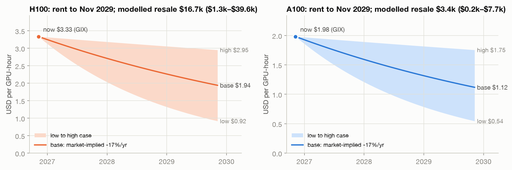

# RSI4GPF: Recursive Self-Improvement with Multi-Agent Reinforcement Learning Framework for GPU Price Forecasting

**An AI scientist that forecasts GPU rental prices and keeps improving itself.** A team of LLM
agents shares one board of evidence, debates from different perspectives and votes. A research
agent proposes and tests hypotheses about what moves prices. RL on Tinker trains the agents on
the scores their own forecasts earn, and population training keeps only the changes that beat
the incumbent on held-out dates.

Built for **Track 2 (Recursive Self-Improvement by Pacific: An AI Scientist for GPU Value)** of
the iterate.inc AI research hackathon, 14–15 Nov 2026. It uses **Direction A** (self-improving
forecasts) together with direction B's memory: a research notebook and a shared evidence board.

| | |
|---|---|
| **Scored question** | Posted GPU rental prices 1, 3 and 7 days after 6 Nov 2026, as q10/q50/q90 for the 37 headline series |
| **Argued question** | H100 and A100 rent and resale value in late 2028 and 2029 |
| **Data** | Pacific's `gpu-price-pack-v0.1.1-handover` only (3.78M posted offers, 31M AWS spot ticks, indices, MLPerf); no external data by default |
| **Model** | `Qwen/Qwen3.5-9B` with LoRA on Tinker, plus code-only scoring with Pacific's own `scorer.py` |
| **Bar to beat** | Pacific's `drift`: +0.20 pooled skill at the 24 Oct cutoff, +0.17 over 15 weekly origins |
| **Findings** | [FINDINGS.md](FINDINGS.md) · tables in [results/report.md](results/report.md) · [results/long_run.md](results/long_run.md) |

> **Status, 14 Nov:**
> - **Built and tested:** every component (27 offline tests), with each piece run end to end on
>   Tinker.
> - **Running:** the overnight self-improvement run, until 08:00 on 15 Nov.
> - **Still to come:** the locked-test results and the submission file, written by
>   `scripts/final.py` after that run. No gain over the baselines is claimed yet.

---

## What the data says



Spot and posted rate cards behave differently, and the pack forbids chaining them:
- AWS spot is an administered price with long flat stretches and sudden repricings. The
  archive is missing March to June 2026, and the chart leaves that gap unfilled.
- A rate-card median moves in discrete steps. The research notebook found that 87% of 7-day
  windows show no change at all, which is why "repeat the last value" is a strong baseline.



Reproduced locally with Pacific's starter demo. Seasonal naive loses because posted prices have
no weekly cycle. The target is drift's skill, with ranges that are honestly calibrated.

## How it works



| Role | Job | LLM or code |
|---|---|---|
| Data Scout | Builds each series' history up to the origin, plus related features and optional news | Code |
| Quant Analyst | Pacific's `last_value_empirical` and `drift` baselines, posted on the board | Code (starter kit) |
| Forecasters ×3 | Independent q10/q50/q90 for 1, 3, 7 and 30 days, each from its own lens, citing evidence IDs | LLM (shared LoRA adapter) |
| Critic | Challenges weak reasoning, ranges that are too narrow, bad citations and any look-ahead | LLM |
| Market Analyst | Summarises news events dated before the origin, when there are any | LLM |
| Aggregator | Weighted vote per quantile; the weights update with each agent's track record | Code |
| Research agent | Proposes the next hypothesis about what moves prices | LLM (the test itself is code) |
| Improver | Proposes bounded edits to prompts, debate settings and the voting rule | LLM |
| Scorer | Pacific's `scorer.py`, unchanged | Code |

## How it improves itself



| Level | What changes | Kept only if |
|---|---|---|
| Research notebook | Hypotheses about price drivers become citable findings on every board | A permutation or bootstrap test on data up to 30 Sep gives p < 0.05 with the predicted sign |
| Agent weights | One LoRA adapter shared by the three Forecaster lenses | It is part of a member that wins the acceptance test |
| Voting weights (fast) | Each Forecaster's weight per instrument class and horizon | Always updated (Hedge), using only outcomes known before the next date |
| Voting rule, prompts, debate (slow) | `eta`, `decay`, `w_min`, `widen`, lens prompts, debate rounds | They win the paired bootstrap on validation |

Rewards come from code, never from another LLM. Every repair to a malformed answer (crossed
quantiles, missing horizons, bad citations) costs reward.

## Evaluation: fixed before looking, with no leaks

| Split | Forecast origins | Truth it may use | Purpose |
|---|---|---|---|
| Train | weekly, 4 Feb – 30 Sep 2026 | up to 30 Sep | RL rewards and research tests |
| Validation | 1, 8, 15 Oct | up to 24 Oct | Acceptance and stopping |
| **Locked test** | **24, 27, 30 Oct** | up to 6 Nov | Scored once, in Pacific's frozen-cutoff mode |
| Submission | 6 Nov | withheld 7–13 Nov | Sunday's score |

- **Scope:** posted rental series with daily truth and at least 30 days of history, chosen from
  the catalog dated at each origin. That is 207–333 series per origin. AWS spot is excluded: it
  has no November truth and is a different instrument.
- **Locked test comparisons:**
  - the trained team, with and without findings;
  - the untrained team;
  - Pacific's `drift` and `last_value_empirical`.

  Each comes with a 90% bootstrap interval and a paired test against drift.

## Results so far

**Research notebook** (all tested on data up to 30 Sep; the research agent proposed H4 itself):

| ID | Hypothesis | Result | Verdict |
|---|---|---|---|
| H1 | Neocloud rate cards usually don't move within 7 days | 87% of 7-day windows unchanged, p = 0.001 | ✅ kept |
| H2 | Large recent moves are followed by large moves | corr(\|past 14 d\|, \|next 7 d\|) = +0.09, p = 0.002 | ✅ kept |
| H3 | Spot prices revert towards their 30-day median | corr = −0.24, p = 0.012 | ✅ kept |
| — | Moves continue over the next 7 days (momentum) | corr = −0.30: short moves partly reverse | ❌ rejected |
| — | A falling provider count precedes price rises | corr = −0.16, p = 0.11 | ❌ rejected |
| H4 | Marketplace collectors follow each other with a one-week lag | not significant | ❌ rejected |

**First loop generations** (short check: 2 generations, 2 members, rental scope at h = 1, 3, 7):

| | Validation pooled skill | Inside [q10, q90] (target 0.80) | Accepted? |
|---|---|---|---|
| Pacific `last_value_empirical` | +0.162 | — | reference |
| Generation 0, best member | +0.167 | 0.72 | no (P(better) = 0.71) |
| Generation 1, Improver edit (`widen` 1.5, reversion lens rewritten) | +0.168 | — | no (P(better) = 0.73) |

Untrained members are level with the baseline, and their ranges are too narrow: 17% of truths
fall above q90, against a 10% target. The acceptance test correctly refuses gains of that size.
The overnight run has to clear it.

## The 2–3 year view (argued from the pack)



Per unit of measured inference work (MLPerf from the pack: H100 = 1, B200 = 3.21), an H100-hour
costs 46% more than a B200-hour, and an A100-hour 114% more. Older chips are expensive per unit
of work, and that gap is downward pressure on their rents.



| GPU, Nov 2029 | Rent low | **Rent base** | Rent high | Resale low | **Resale base** | Resale high |
|---|---|---|---|---|---|---|
| H100 | $0.92 | **$1.94** | $2.95 | $1.3k | **$16.7k** (≈50% of launch) | $39.6k |
| A100 | $0.54 | **$1.12** | $1.75 | $0.2k | **$3.4k** (≈22% of launch) | $7.7k |

- **Base case:** the decline the market itself implies. GetDeploying's 36-month reserved price
  is 0.77× on-demand for H100 and 0.76× for A100, which works out to about **−17%/yr**.
- **Low case:** −35%/yr, about the fall of AWS H100 spot after launch.
- **High case:** −4%/yr, the A100's four-year AWS spot trend.
- **Resale:** modelled as the present value of the remaining net earnings after power and
  operations. It is not a quoted price, because no open resale data exists.
- **For a lessor or lender:** set collateral haircuts against the low case, and watch the
  reserved-to-on-demand ratio weekly. It is the cheapest leading indicator in the pack.

Full assumptions: [results/long_run.md](results/long_run.md).

## Deliverables (brief, section 7)

| Required | Where |
|---|---|
| Forecasts, origin 2026-11-06, horizons 1, 3, 7, starter-kit format | `submission/forecast_2026-11-06.csv` (written by `scripts/final.py`, checked in frozen-cutoff mode) |
| One command that reproduces them | `bash reproduce.sh` (`MODE=base` needs no checkpoint; `MODE=full` reruns the loop) |
| Findings | [FINDINGS.md](FINDINGS.md) |
| Attribution | [docs/ATTRIBUTION.md](docs/ATTRIBUTION.md), copied unchanged from the pack |

## Quick start

```bash
python3 -m venv .venv && .venv/bin/pip install -e ".[dev]"
cp .env.example .env                       # add TINKER_API_KEY
# put the pack zip (Track 2 Google Drive folder) at data/raw/, then:
bash reproduce.sh                          # verify pack → tests → locked test → submission → report
```

| Command | What it does |
|---|---|
| `.venv/bin/python -m pytest -q` | 27 offline tests: no look-ahead, rewards, parsing, voting, acceptance test, notebook |
| `.venv/bin/python scripts/run_origin.py --origin 2026-10-15 --llm fake` | One forecast date offline, scored by Pacific's scorer |
| `.venv/bin/python scripts/run_origin.py --origin 2026-10-15 --llm tinker --limit 3` | The same on Tinker |
| `.venv/bin/python scripts/rsi_loop.py --deadline 2026-11-15T08:00` | The self-improvement loop (`configs/rsi.yaml`) |
| `.venv/bin/python scripts/final.py --best outputs/rsi/<run>/best.json` | Locked test, ablations and the submission |
| `.venv/bin/python scripts/long_run.py` | The 2–3 year view |
| `.venv/bin/python scripts/figures.py` | Regenerates the figures in this README |
| `.venv/bin/python scripts/collect.py events --start 2026-05-01` | Optional news events from Exa (needs `EXA_API_KEY`) |

## Repository

```
gpr/
  pack.py        Pacific's starter scripts (series, baselines, scorer), splits, rental scope
  board.py       the shared board: evidence IDs, positions, challenges
  agents.py      prompts and strict JSON parsing for Forecasters, Critic, Market Analyst
  team.py        one forecast date: independent round → debate → weighted vote
  weights.py     Hedge voting weights with decay and a floor
  research.py    the research notebook: hypothesis families, tests, findings
  rewards.py     cell skill, penalties, truth caps
  rl.py          GRPO-style RL steps on a Tinker LoRA adapter
  evaluate.py    validation with voting updates, paired bootstrap
  improve.py     the Improver's whitelisted, bounded edits
  loop.py        generations, exploit and explore, acceptance, stopping
  llm.py fake.py Tinker sampler (fixed seeds) and an offline fake
  data/          optional Exa collector and a time-sliced store
scripts/         run_origin, rsi_loop, final, long_run, report, figures, collect
configs/         team_v0.yaml, rsi.yaml, sources.yaml
results/         report.md, long_run.md (and final.json, notebook.jsonl after the run)
docs/            PLAN.md, ATTRIBUTION.md, figures/
```

## Rules we follow (pack DATA.md and the brief)
- **No look-ahead:** every agent sees only rows dated on or before the origin, and tests fail
  on any leak.
- **No chaining:** instrument classes are never combined into one series. Each target declares
  its class and contract.
- **Prices are posted, not paid.** Resale is modelled, and the resale publishers in the pack are
  cited, not stored.
- **External data:** only data that is public, free to every team and dated before the origin.
  None is used by default.
- **Open question:** several Tinker base models may have seen some 2026 price pages during
  pretraining. The research tests and baselines don't depend on this; the LLM forecasts could.
